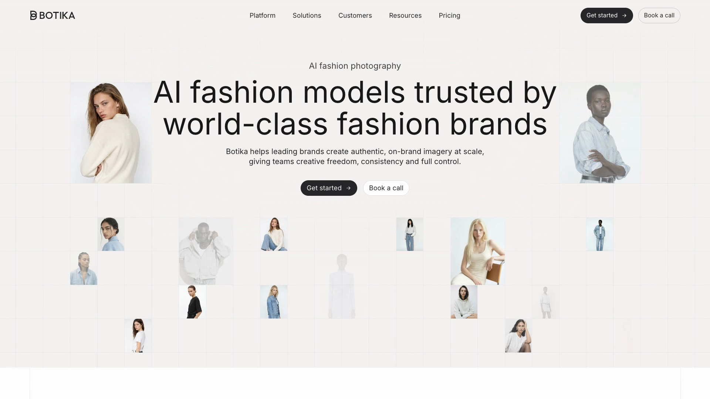

# landing-page-skills

Thirteen [Claude Code](https://claude.com/claude-code) skills that take a landing page from past-page analytics and a Figma file to a measured launch.

They are how we build our own pages at Botika: motion written in Figma, the page built on Webflow, imagery from our own engine, QA that measures instead of squints. This repository is the part that is not private.

[](video/out/home-v2-1-scroll-1080p60.mp4)

*The reel above is a real capture of one of our pages (1080p, 60 fps): the hero builds, a statement splits around a circle, four chapters build their product cards, a wall of models counts up and picks one, three benefit cards animate. Recorded with the tools in `video/`. Nothing in it was re-created.*

## The pipeline

One hub skill, twelve stage skills. Each stage writes a file the next stage reads, and a gate decides whether you move on.

| # | Skill | Does | Writes |
|---|---|---|---|
| 0 | [`landing-page-pipeline`](skills/landing-page-pipeline/SKILL.md) | the hub: stages, handoffs, the four human decisions | folder contract |
| 1 | [`learning-from-past-pages`](skills/learning-from-past-pages/SKILL.md) | reads old pages, tests and recordings before anything is designed | `00-learnings.md` |
| 2 | [`concepting-a-website`](skills/concepting-a-website/SKILL.md) | the argument, the claim sequence, a proof picture per claim | `01-concept.md` |
| 3 | [`extracting-figma-truth`](skills/extracting-figma-truth/SKILL.md) | fills not renders, comments as brief, type widths within 1% | `02-figma-truth/` |
| 4 | [`specifying-motion-in-figma`](skills/specifying-motion-in-figma/SKILL.md) | motion notes beside each frame, with numbers | `03-motion-spec.md` |
| 5 | [`art-directing-site-imagery`](skills/art-directing-site-imagery/SKILL.md) | imagery as a set that proves its copy, from an engine | `04-imagery/` |
| 6 | [`writing-claims-that-hold`](skills/writing-claims-that-hold/SKILL.md) | the claims ledger, cleared numbers only | `05-claims-ledger.md` |
| 7 | [`designing-page-layout`](skills/designing-page-layout/SKILL.md) | one scale, one section system, rhythm measured at every junction | `06-tokens.md` |
| 8 | [`choreographing-scroll-stories`](skills/choreographing-scroll-stories/SKILL.md) | pinned scenes as a function of one number, a scroll budget | scene timelines |
| 9 | [`animating-web-pages`](skills/animating-web-pages/SKILL.md) | making motion run, and run well, with three fallbacks | working motion |
| 10 | [`building-webflow-pages`](skills/building-webflow-pages/SKILL.md) | the Webflow Designer traps; every write read back | the staged page |
| 11 | [`reviewing-page-design`](skills/reviewing-page-design/SKILL.md) | QA on mobile and desktop; every finding has a number | `08-qa-report.md` |
| 12 | [`making-a-page-reel`](skills/making-a-page-reel/SKILL.md) | records the real animation, picks the path by measurement | `09-reel.mp4` |

```
learn -> concept -> figma truth -> motion spec -> ┬ imagery ┐
                                                  ├ claims  ├-> build -> QA -> reel
                                                  └ layout  ┘     (scroll stories + animation run as one loop)
```

Handoffs and gates: [docs/handoffs.md](docs/handoffs.md).

## Our engine, our art director

Imagery on our pages is rendered in our own engine, Botika, never stock and never crops of old pages. A skill sits on top of it as the art director: it holds the brief's constants (palette, light, crop, continuity), picks the model, pose, outfit and background per image, runs the batch and checks the results against the required style.

That art director skill drives a private render pipeline, so it is **not in this repository**. What is here is the contract it fulfils, in [`art-directing-site-imagery`](skills/art-directing-site-imagery/SKILL.md): what any engine must be given, what it must return, and the native-resolution QA every image passes. If your engine cannot take the brief's constants as input, the art director is a person with that skill as a checklist.

## Figma is still the source. The build is independent.

We still do a lot in Figma. It carries the design, the motion direction and the review comments, and the agent reads all three. What changed is who does the middle: the agent turns a frame into a page, measures the page against the frame and sends back the differences. A person holds four decisions: which claims are cleared, which imagery is approved, staging review, and the production publish. Everything between those gates runs without a person in the loop. See [docs/figma-and-independence.md](docs/figma-and-independence.md).

## Install

As a plugin:

```
/plugin marketplace add igal-commits/landing-page-skills
/plugin install landing-page-skills@landing-page-skills
```

Or copy the skills (nothing is overwritten unless you pass `--force`):

```
git clone https://github.com/igal-commits/landing-page-skills
cd landing-page-skills && ./install.sh
```

Then ask: *"Use landing-page-pipeline to rebuild our pricing page. Start with learning-from-past-pages."*

## Tools

| Tool | What it does |
|---|---|
| [`tools/scroll-qa.mjs`](tools/scroll-qa.mjs) | Real wheel input through Chrome: pin length in viewport heights and notches, seconds to reach each pin, one-notch settle time, frame jank |
| [`tools/page-measure.js`](tools/page-measure.js) | One snippet: horizontal overflow, junction gaps, title sizes, text floor, headings, images, card heights, placeholders, em dashes |
| [`video/capture.mjs`](video/capture.mjs) | Records the real page animation by CDP screencast at about 60 fps, scrolls through the page's own smooth-scroll library, resamples to a constant frame rate |
| [`video/analyze.py`](video/analyze.py) | Finds frozen runs and motion spikes, so the scroll path is shaped by measurement |
| [`video/encode.sh`](video/encode.sh) | Encodes to H.264 with the colour matrix converted and tagged |
| [`tools/lint-pack.mjs`](tools/lint-pack.mjs) | Lints the skills and scans the repo for secrets, internal ids and private paths |

`scroll-qa.mjs` and `capture.mjs` need Node, Chrome and `puppeteer-core`. Point `PUPPETEER_FROM` at a folder with `node_modules/puppeteer-core`.

## Evidence

Selected measurements on the page in the reel: [docs/evidence.md](docs/evidence.md). Testing status of each skill: [docs/testing.md](docs/testing.md).

## What is not here

- The art director skill and the render pipeline behind it (private).
- The CMS publishing skill and the brand's copy and voice skills (private).
- Customer names, logos, prices, plans and the private design file. The pack names none of them.

## License

MIT. See [LICENSE](LICENSE).
